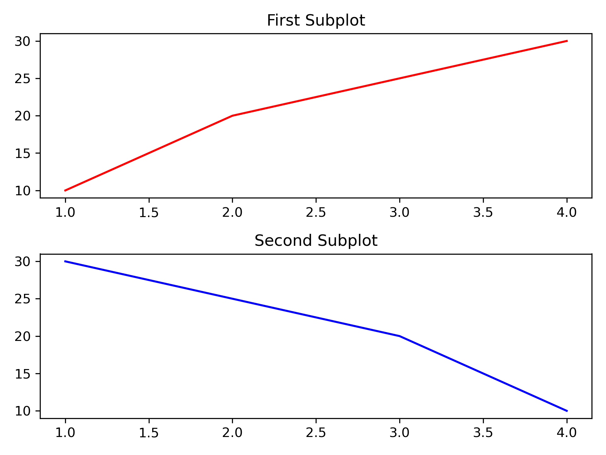
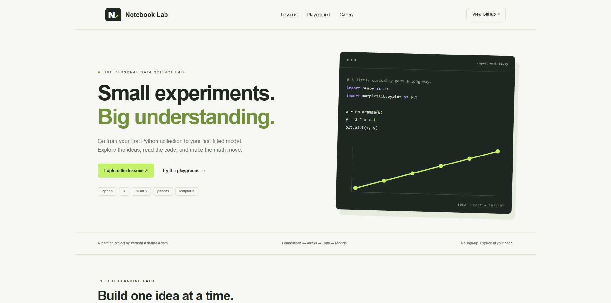
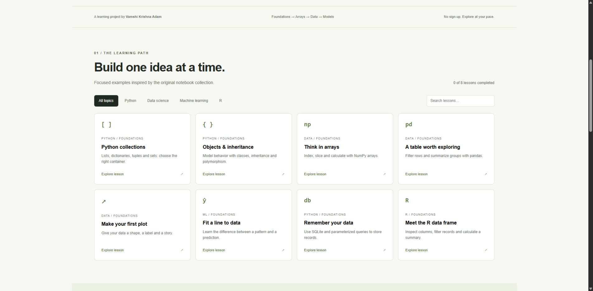
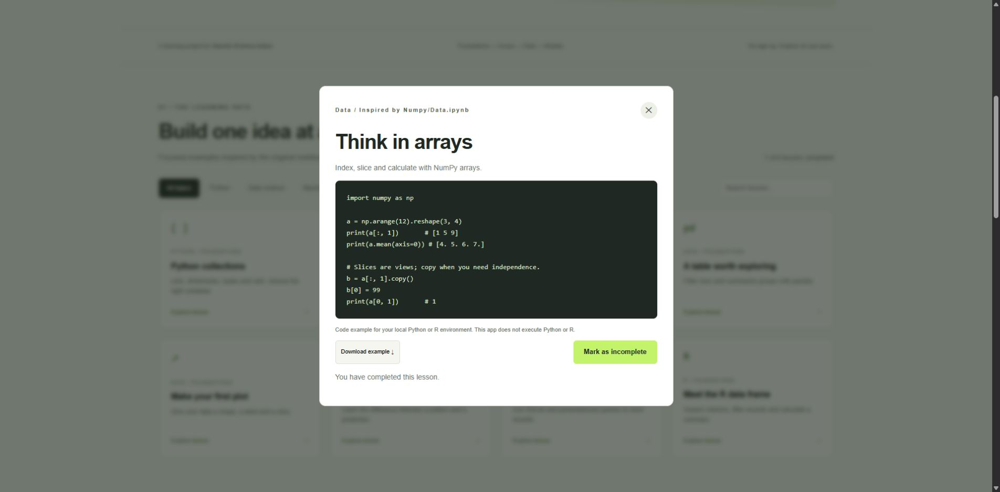
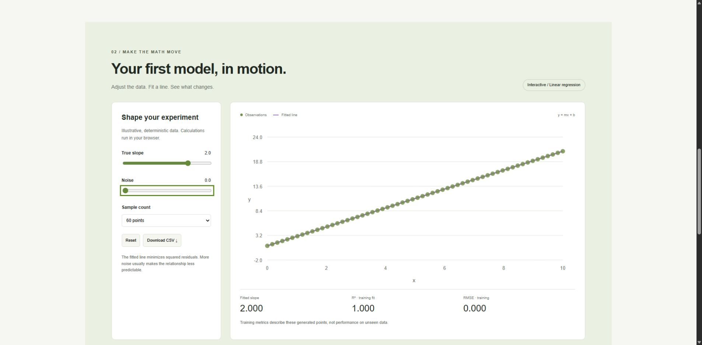
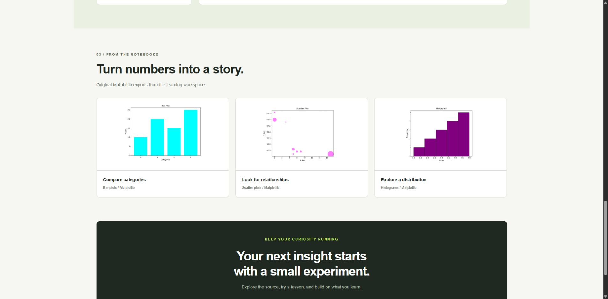
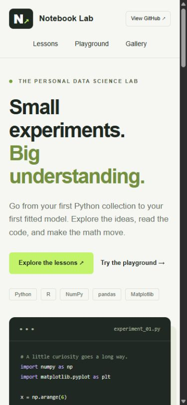

# Notebook Lab — ML, Python & R Data Science

A personal learning notebook project by **Vamshi Krishna Adam**, covering Python programming, R, numerical computing, data manipulation, visualization, and introductory machine learning.



*An actual plotting example from the local learning workspace.*

## Project overview

This project documents hands-on practice across the Python data science ecosystem and introductory R. The learning materials progress from core collections and object-oriented programming to NumPy arrays, pandas workflows, Matplotlib figures, file handling, SQLite, and regression/classification examples.

## Live interactive demo

[**Open Notebook Lab →**](https://python-r-learning-lab-vams2krish.adam-vamshikrishna.chatgpt.site)

The hosted demo is **owner-private and requires the owner's ChatGPT sign-in**. This GitHub repository is public, and the app runs locally without login.

The runnable companion in [`web/`](web/) includes:

- Eight curated Python, R, NumPy, pandas, Matplotlib, SQLite and ML examples.
- Topic filters, text search, empty states and accessible lesson dialogs.
- Downloadable `.py` and `.R` examples, with completion progress stored on your device.
- Interactive linear regression: adjust slope, noise and sample count; inspect fitted slope, R² and RMSE; export generated data as CSV.
- An original Matplotlib plot gallery and responsive layouts.

Python/R snippets are read/download examples for local execution. The regression simulator runs in JavaScript in the browser. Generated data is illustrative, and displayed metrics describe training fit.

## Project showcases

Actual Chrome screenshots of the local release app. Click an image to inspect it at full size.

### Welcome to the lab



### Explore the learning path



### Read code and track progress



### Experiment with regression



### Original plot gallery



### Mobile experience



## Run the web app locally

Requires Node.js 22 or newer. No npm installation or API key is required.

```sh
git clone https://github.com/vams2krish/ML-Python-R-Data-Science-Notebooks.git
cd ML-Python-R-Data-Science-Notebooks/web
npm start
```

Open `http://127.0.0.1:4173`.

```sh
npm test
```

The production files are in `web/dist/` and can be hosted by a static web server. `web/server.js` is a loopback development server. Sites deployment metadata is in `web/.openai/hosting.json`; creating a separate Site requires its own Site identity.

## Verification

Six automated tests passed. Browser checks covered filtering/search, lesson completion across reload, code and CSV downloads, exact/negative regression fits, reset, gallery images and a mobile viewport. Seven Python examples passed syntax compilation; the collections, objects and SQLite examples ran successfully.

Sites confirmed successful deployment. The production sign-in gate was checked, but an authenticated production walkthrough remains unverified because the browser was logged out. See the [verification record](docs/VERIFICATION.md) for results and limits. CI runs the model tests and JavaScript syntax check on pushes and pull requests.

## Repository structure

```text
web/
  dist/                 Static app, lessons, model and plot assets
  examples/             Downloadable Python and R examples
  tests/model.test.js   Regression and lesson tests
  server.js             Local development server
  export-examples.mjs   Regenerate examples from the lesson catalog
assets/showcase/        Six actual browser screenshots
docs/VERIFICATION.md    Test results and deployment limits
.github/workflows/     Continuous integration checks
```

**Original notebook status:** the inventory below describes the local learning collection. The original notebooks, scripts and datasets are not uploaded; the public repo contains the runnable companion, curated examples, selected plot exports and documentation.

## Topics and notebook inventory

| Area | Local learning materials | Coverage |
| --- | --- | --- |
| Python collections | `1.List Tutorial.ipynb`, `2.Dictionary Tutorial.ipynb`, `3.Tuples Tutorial.ipynb`, `4. Sets.ipynb`, `5.Arrays.ipynb` | Accessing, modifying, slicing, iterating, set operations, and practice exercises |
| Object-oriented programming | `6.Class & Objects.ipynb`, `7.Inheritance (all types) & super func.ipynb`, `8.Encapsulation Tutorial.ipynb`, `9.Abstraction.ipynb`, `10.Polymorphism Tutorial.ipynb` | Classes, objects, inheritance, `super()`, encapsulation, abstract classes, and polymorphism |
| NumPy | `Data.ipynb`, `Numpy/Data.ipynb` | Array indexing, slicing, splitting, copies/views, and linear algebra |
| pandas | `Pandas Tutorial.ipynb` | Tabular data practice with pandas and plotting |
| Matplotlib | `Matplotlib Tutorial.ipynb`, `3d test.py` | Line plots, customization, subplots, bars, scatter plots, histograms, pie charts, 3D examples, and animation practice |
| Files and persistence | `File Handling.ipynb`, `file_handling.ipynb`, `sqlite3.ipynb` | Text and CSV handling, file modes, and SQLite table creation/insertion |
| Machine learning | `Sci-Kit Learn Tutorial.ipynb`, `Linear Regression.ipynb`, `Logistic Regression Tutorial.ipynb` | Dataset loading, train/test splits, linear regression, digit classification, and model evaluation |
| R | `R_Language/` | Introductory scripts, data import, data-frame inspection, and coursework exercises |

The local workspace also contains CSV, Excel, JSON, text, and NumPy data files, plus exported plot images. Selected plot exports appear in the web gallery; the other supporting files remain local.

## Suggested learning sequence

1. Work through the numbered Python collection notebooks.
2. Continue with classes, inheritance, encapsulation, abstraction, and polymorphism.
3. Practice NumPy indexing, array operations, and linear algebra.
4. Explore pandas tabular workflows and file formats.
5. Build and customize Matplotlib charts.
6. Study file handling and SQLite persistence.
7. Move to scikit-learn, linear regression, and logistic regression.
8. Explore the R exercises alongside the Python material.

## Working with the local notebooks

These instructions apply when you have the original learning files available locally or after they are added to the repository.

### Python environment

Install a compatible Python 3 release and create a virtual environment. From the learning folder on Windows PowerShell:

```powershell
python -m venv .venv
.\.venv\Scripts\Activate.ps1
python -m pip install --upgrade pip
python -m pip install jupyterlab numpy pandas matplotlib seaborn scikit-learn openpyxl
jupyter lab
```

Open a notebook in JupyterLab and run its cells in order. The package list reflects the main libraries used in the collection; it is not a pinned or tested dependency specification. One list tutorial also imports TensorFlow, which is optional for the core collection exercises and requires its own compatible environment if that cell is used. SQLite, `array`, and `abc` are included in Python's standard library.

### R environment

Install R and optionally RStudio. The R scripts use `readr`:

```r
install.packages("readr")
library(readr)
```

Update local file paths before running the scripts. Some exercises reference external teaching data and may require corrections to paths or object names.

## Practical notes

- This is a learning collection with exploratory examples, rather than a packaged application.
- Some cells write files or insert database rows; inspect them before rerunning.
- Data-dependent examples require their corresponding input files and valid local paths.
- Animation export in `3d test.py` requires FFmpeg.
- The original notebook suite and its dependency compatibility have not been validated; the web companion has separate tests listed above.
- Existing comments and examples may contain mistakes or incomplete exercises; validate behavior as part of practice.

## Learning goals

Build confidence with Python fundamentals, understand array and data-frame operations, communicate results with charts, practice basic data persistence, and develop a foundation for statistical computing and machine learning in Python and R.

## Author

**Vamshi Krishna Adam** · [GitHub profile](https://github.com/vams2krish)

## License

No open-source license has been selected. Public visibility alone does not grant a license to reuse or redistribute the materials.
